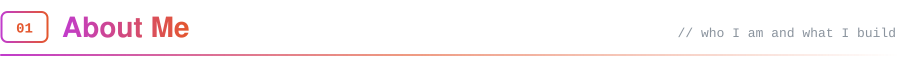
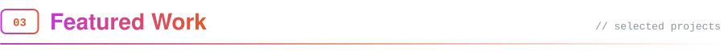
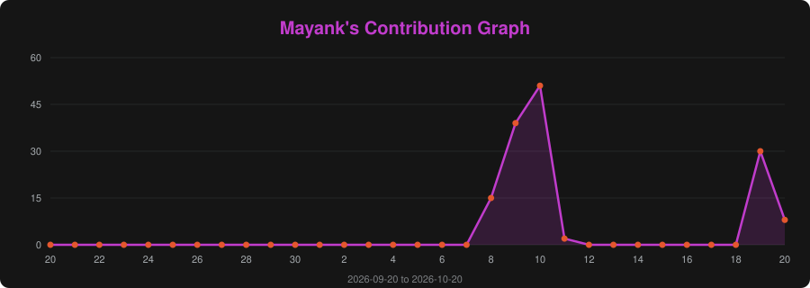

<a name="top"></a>

<p align="center">
  
</p>

<p align="center">
  
</p>

<p align="center">
  <a href="https://mynk03.co.in/"></a>
  <a href="https://www.linkedin.com/in/mynk03"></a>
  <a href="https://leetcode.com/u/mynk03/"></a>
  <a href="mailto:mayank4code@gmail.com"></a>
  
</p>

---

<a id="about"></a>


```ts
const mayank = {
  role: "Full Stack Developer",
  title: "System Analyst @ Ancilar",
  stack: ["TypeScript", "Node.js", "React", "Next.js", "Go", "Python"],
  building: ["microservice backends", "payments and escrow", "AI-agent platforms", "Web3 infra"],
  degree: "B.Tech, Computer Science and Engineering (LNCT Bhopal, 2024)",
  openTo: "full stack and backend roles",
};
```

I'm a full stack developer with **2+ years** of full-time experience building API-driven web products across freelance marketplaces, payments, Web3 and AI-agent applications. Most of my work is **TypeScript / Node.js** backend services (REST APIs, PostgreSQL and MongoDB, background jobs, payment integrations, real-time updates) alongside **React / Next.js** frontends. I also build services in **Go** and **Python**.

- At **Ancilar** (since Aug 2024): 10-service TypeScript backend with Stripe Connect escrow for FiduWork, Solana sync workers for Wewe, a multi-DEX order router, and a FastAPI backend for an AI-agent platform on the Claude Agent SDK.
- Built a Go relayer that settles up to **100 gasless tips per transaction**, and another that cut cross-chain message latency by **45%**.
- Before that, built Yuva Portal's React frontend and 20+ endpoint REST API for **100,000+ users**, with **30%** faster data processing and **99%** uptime.

> **Open to:** full stack and backend roles - TypeScript / Node.js services, React / Next.js products, distributed systems, Web3 and AI-agent platforms. [Reach out →](mailto:mayank4code@gmail.com)

---

<a id="stack"></a>


<table>
<tr>
<td width="180" valign="middle"><b>Languages</b></td>
<td valign="middle">
<a href="https://skillicons.dev"></a>
</td>
</tr>
<tr>
<td width="180" valign="middle"><b>Backend &amp; Data</b></td>
<td valign="middle">
<a href="https://skillicons.dev"></a>
</td>
</tr>
<tr>
<td width="180" valign="middle"><b>Frontend</b></td>
<td valign="middle">
<a href="https://skillicons.dev"></a>
</td>
</tr>
<tr>
<td width="180" valign="middle"><b>DevOps &amp; Observability</b></td>
<td valign="middle">
<a href="https://skillicons.dev"></a>
</td>
</tr>
<tr>
<td width="180" valign="middle"><b>APIs &amp; Queues</b></td>
<td valign="middle">


</td>
</tr>
<tr>
<td width="180" valign="middle"><b>Distributed Systems</b></td>
<td valign="middle">


</td>
</tr>
<tr>
<td width="180" valign="middle"><b>Web3</b></td>
<td valign="middle">


</td>
</tr>
<tr>
<td width="180" valign="middle"><b>Integrations</b></td>
<td valign="middle">


</td>
</tr>
</table>

---

<a id="work"></a>


| Project | What it is | Stack |
| --- | --- | --- |
| **FiduWork** | Freelance marketplace backend: 10 TypeScript microservices with JWT / RBAC, Stripe Connect escrow, and a BullMQ chain indexer. | TypeScript, Node.js, MongoDB, Next.js |
| **AgenticStudio** | AI-agent platform on the Claude Agent SDK: FastAPI backend with each agent in its own Docker container. | Python, FastAPI, PostgreSQL, React |
| **SocialFi** | Gasless creator tipping: Go relayer on RabbitMQ that settles up to 100 tips per transaction. Presented at Yellow Network Hackathon 2025. | Go, RabbitMQ, MongoDB, Next.js |
| **Wewe** | Solana token launch platform: Helius sync workers with distributed locks and trading-volume rewards. | TypeScript, Node.js, MongoDB |
| **HyperDex** | Telegram-driven smart order router that splits orders across three perp DEXs. | TypeScript, Hyperliquid |
| **HyperPNL** | On-chain prop trading: perp simulator with live PnL over WebSockets and an ERC-4337 paymaster and bundler. | Node.js, WebSocket, Solidity |
| **UnitokenSwap** | Intent-based swap protocol: gasless EIP-712 / Permit2 intents and RFQ auctions across 7 Rust microservices. | Rust, Axum, PostgreSQL, Redis |
| **Blocky Txn** | Blockchain simulator: Go execution node with libp2p gossip, a Merkle Patricia Trie on LevelDB, and gRPC APIs. | Go, libp2p, gRPC, LevelDB |
| **Yuva Portal** | REST API with 20+ endpoints serving 100,000+ users for Young Indians, with 99% uptime. | Node.js, Express.js, MongoDB |

---

<a id="highlights"></a>


- **Podium finish at National Agro Hackathon 2023** among 200+ teams (WasteConnect).
- Presented **SocialFi** at **Yellow Network Hackathon 2025**, IIT Delhi.

---

<a id="stats"></a>


<div align="center">





<a href="https://leetcode.com/u/mynk03/"></a>



<picture>
  <source media="(prefers-color-scheme: dark)" srcset="https://raw.githubusercontent.com/mynk03/mynk03/output/github-contribution-grid-snake-dark.svg" />
  <source media="(prefers-color-scheme: light)" srcset="https://raw.githubusercontent.com/mynk03/mynk03/output/github-contribution-grid-snake.svg" />
  
</picture>

</div>

---

<a id="connect"></a>


<p align="center">
  <a href="https://mynk03.co.in/"></a>
  <a href="https://www.linkedin.com/in/mynk03"></a>
  <a href="https://leetcode.com/u/mynk03/"></a>
  <a href="mailto:mayank4code@gmail.com"></a>
</p>

<p align="center"><i>Building something with TypeScript, Node.js, React or Web3? Happy to talk.</i></p>

<p align="center">
  
</p>
